# AST

## Programme

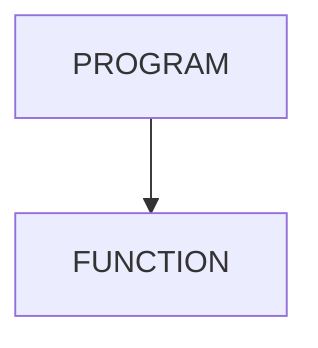

Le noeud `PROGRAM` contient une ou plusieurs fonctions, dans l'ordre où elles sont définies.

## Fonction

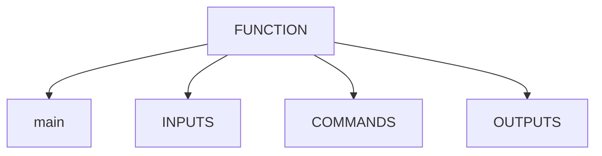

Le noeud `FUNCTION` comprend 4 noeuds :

- Le premier correspond au nom de la fonction (`main`).
- Le deuxième `INPUTS` correspond aux variables d'entrée.
- Le troisième `COMMANDS` correspond au corps de la fonction.
- Le dernier `OUTPUTS` correspond aux variables de sortie.

## Inputs

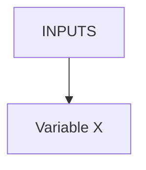

Le noeud `INPUTS` contient les variables utilisées comme paramètres d'entrée de la fonction. Dans cet arbre, il contient une seule variable : `X`.

## Outputs

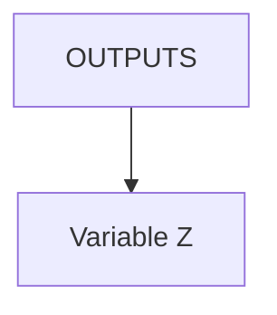

Le noeud `OUTPUTS` contient les variables de sortie de la fonction. Dans cet arbre, il contient une seule variable : `Z`.

## Commands

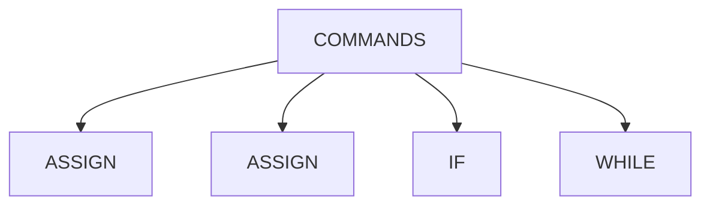

Le noeud `COMMANDS` contient plusieurs commandes, dans l'ordre où elles sont exécutées.

Dans cet arbre, il contient deux affectations, une condition `IF` et une boucle `WHILE`.

## Assign

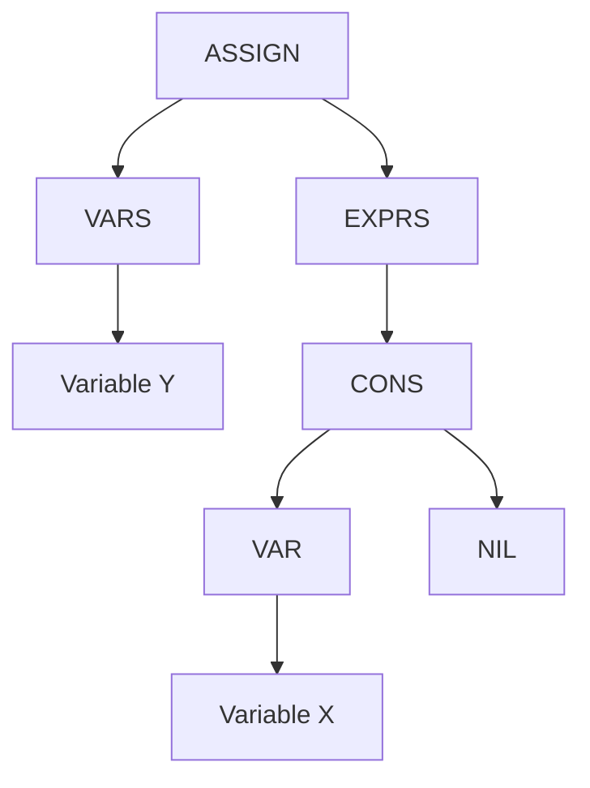

Le noeud `ASSIGN` comprend 2 noeuds :

- Le premier `VARS` correspond aux variables qui seront affectées.
- Le deuxième `EXPRS` correspond aux expressions dont les valeurs seront affectées aux variables définies dans le noeud `VARS`.

Dans cet arbre, la première affectation construit une liste contenant la variable `X` et `NIL`, puis affecte cette liste à `Y`.

La deuxième affectation construit une liste contenant `Y` et `NIL`, puis affecte cette liste à `Z`.

## If

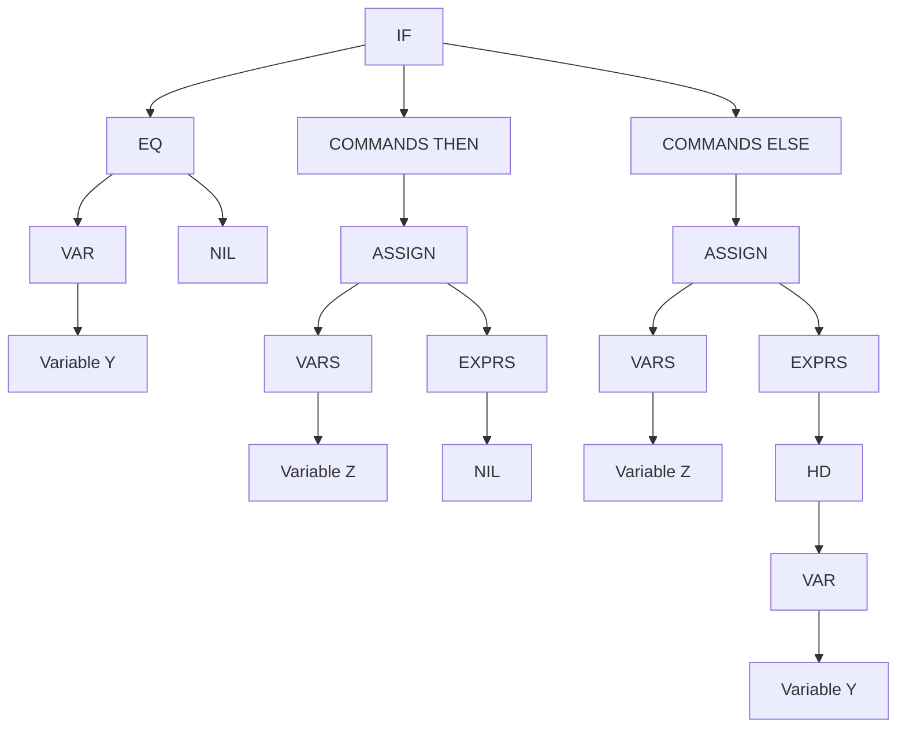

Le noeud `IF` comprend 3 noeuds :

- Le premier `EQ` correspond à la condition d'exécution. Il teste l'égalité entre `Y` et `NIL`.
- Le deuxième `COMMANDS` correspond aux instructions exécutées si la condition est vraie.
- Le troisième `COMMANDS` correspond aux instructions exécutées si la condition est fausse.

Dans cet arbre :

- Si `Y` est égal à `NIL`, on affecte `NIL` à `Z`.
- Sinon, on affecte le premier élément de `Y` à `Z` grâce à l'opération `HD`.

## While

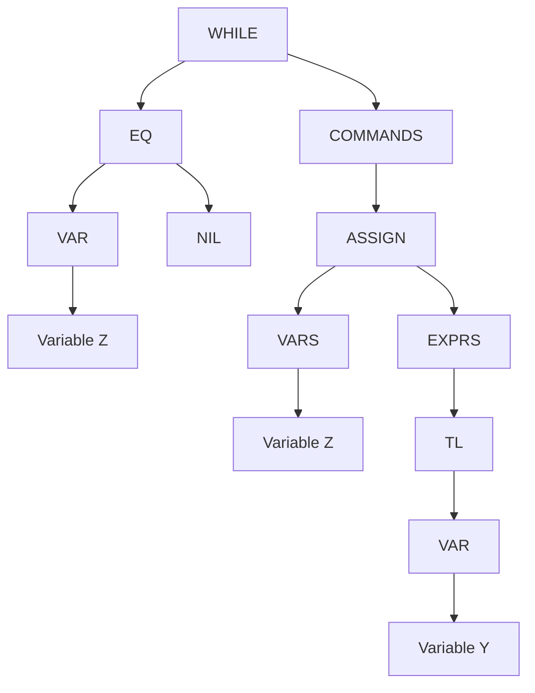

Le noeud `WHILE` comprend 2 noeuds :

- Le premier `EQ` correspond à la condition de la boucle. Il teste l'égalité entre `Z` et `NIL`.
- Le deuxième `COMMANDS` correspond aux instructions répétées tant que la condition est vraie.

Dans cet arbre, tant que `Z` est égal à `NIL`, on affecte à `Z` le résultat de l'opération `TL` appliquée à `Y`.

## Eq

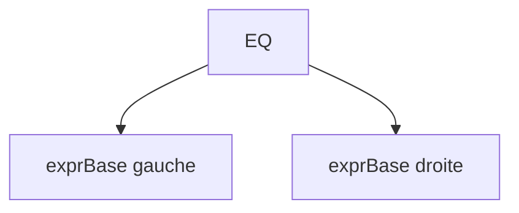

Le noeud `EQ` comprend 2 noeuds : les deux expressions dont on teste l'égalité avec l'opérateur `=?`.

Dans cet arbre, il est utilisé dans les conditions du `IF` et du `WHILE`.

## Vars

Le noeud `VARS` contient une ou plusieurs variables auxquelles les valeurs seront affectées.

## Exprs

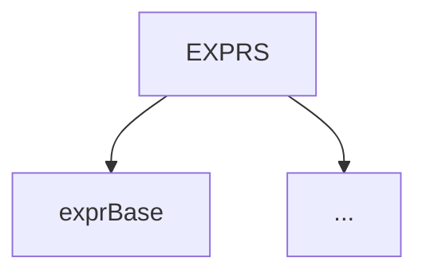

Le noeud `EXPRS` contient une ou plusieurs expressions correspondant aux valeurs à affecter aux variables du noeud `VARS`.

## Var

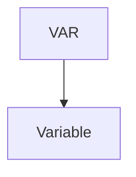

Le noeud `VAR` comprend un seul enfant : le nom de la variable.

Dans cet arbre, les variables utilisées sont `X`, `Y` et `Z`.

## Nil

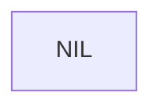

Le noeud `NIL` n'a aucun enfant : il représente la liste vide.

## Cons

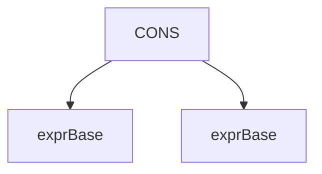

Le noeud `CONS` contient zéro ou plusieurs expressions. Il permet de construire une liste à partir de ses éléments.

Dans cet arbre, il est utilisé pour construire deux listes :

- Une première liste contenant `X` et `NIL`.
- Une deuxième liste contenant `Y` et `NIL`.

## Hd

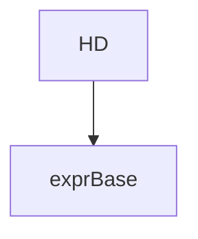

Le noeud `HD` comprend un seul enfant : l'expression sur laquelle l'opération s'applique.

Il permet de récupérer le premier élément d'une liste.

Dans cet arbre, il est appliqué à la variable `Y`.

## Tl

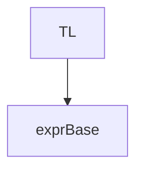

Le noeud `TL` comprend un seul enfant : l'expression sur laquelle l'opération s'applique.

Il permet de récupérer la liste privée de son premier élément.

Dans cet arbre, il est appliqué à la variable `Y`.
