## AST

### Programme

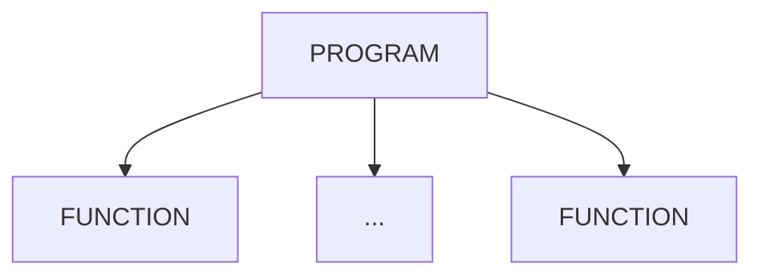

Le noeud `PROGRAM` contient une ou plusieurs fonctions, dans l'ordre où elles sont définies.

### Fonctions

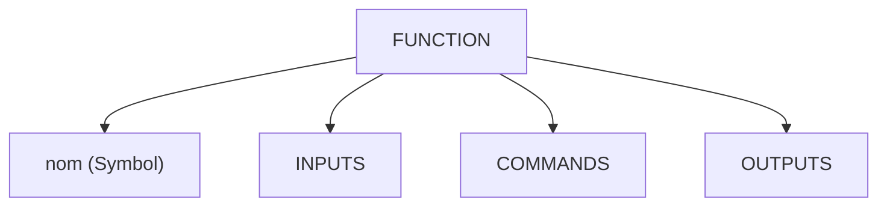

Le noeud fonction comporte 4 noeuds :

- Le premier correspond au nom de la fonction.
- Le deuxième `INPUTS` correspond aux paramètres d'entrée de la fonction.
- Le troisième `COMMANDS` correspond au corps de la fonction.
- Le dernier `OUTPUTS` correspond aux variables de sortie.

### Commandes

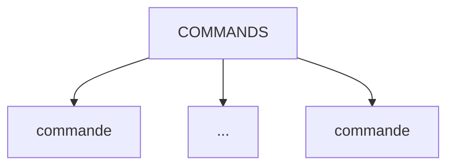

Le noeud `COMMANDS` contient une ou plusieurs commandes, dans l'ordre où elles sont exécutées.

### Nop

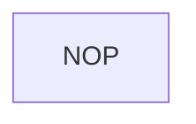

Le noeud `NOP` n'a aucun enfant : il représente une commande qui ne fait rien.

### Assign

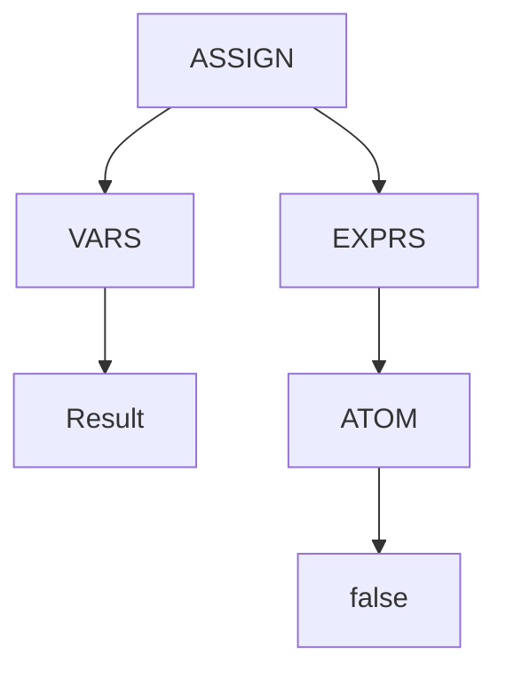

Le noeud `ASSIGN` comprend 2 noeuds :

- Le premier `VARS` correspond aux variables qui seront affectées.
- Le deuxième `EXPRS` correspond aux expressions dont les valeurs seront affectées aux variables définies dans le noeud `VARS`.

### If

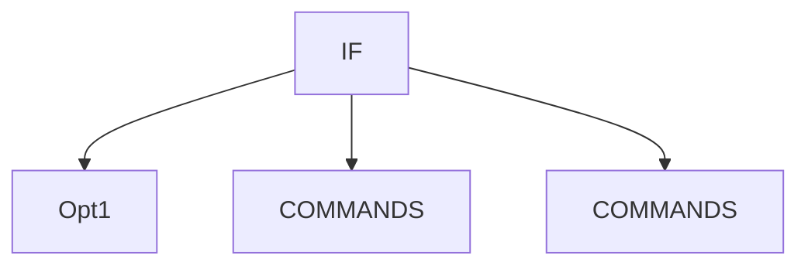

Le noeud `IF` comprend 3 noeuds :

- Le premier `Opt1` correspond à la condition d'exécution.
- Les deux autres `COMMANDS` correspondent aux instructions à exécuter si la condition est vraie ou fausse.

Si la commande n'a pas de `else`, le noeud `IF` ne contient que 2 noeuds :

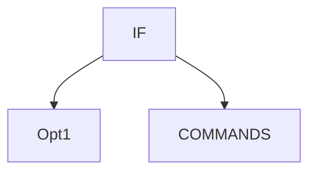

### While

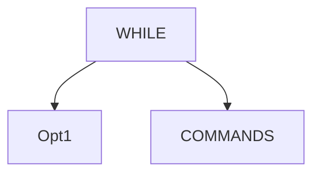

Le noeud `WHILE` comprend 2 noeuds :

- Le premier `Opt1` correspond à la condition de la boucle.
- Le deuxième `COMMANDS` correspond aux instructions répétées tant que la condition est vraie.

### For

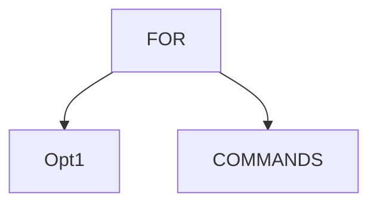

Le noeud `FOR` comprend 2 noeuds :

- Le premier `Opt1` correspond à l'expression qui détermine le nombre de répétitions.
- Le deuxième `COMMANDS` correspond aux instructions à répéter.

### Foreach

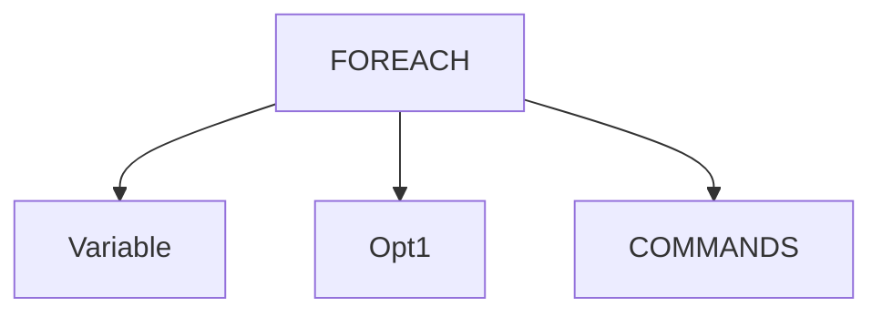

Le noeud `FOREACH` comprend 3 noeuds :

- Le premier correspond à la variable qui prend successivement chaque élément de la liste.
- Le deuxième `Opt1` correspond à l'expression dont la valeur est la liste à parcourir.
- Le troisième `COMMANDS` correspond aux instructions exécutées pour chaque élément.

### Nil

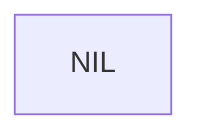

Le noeud `NIL` n'a aucun enfant : il représente la liste vide (et la valeur « faux »).

### Var

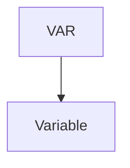

Le noeud `VAR` comprend 1 noeud : le nom de la variable (commence par une majuscule).

### Atom

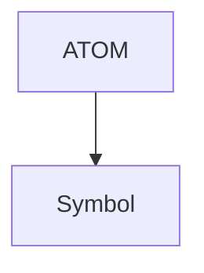

Le noeud `ATOM` comprend 1 noeud : le symbole (commence par une minuscule).

### Eq

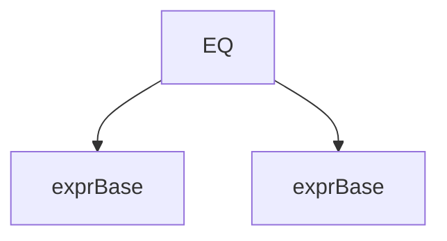

Le noeud `EQ` comprend 2 noeuds : les deux expressions dont on teste l'égalité (`=?`).

### Cons et List

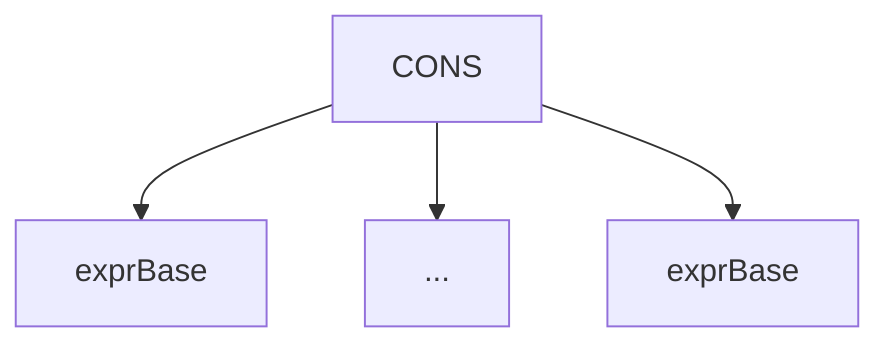

Les noeuds `CONS` et `LIST` ont la même forme : ils contiennent 0 ou plusieurs expressions, qui sont les éléments de la liste.

### Hd et Tl

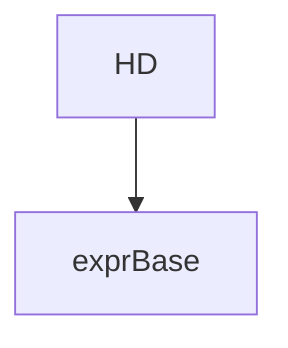

Les noeuds `HD` (premier élément) et `TL` (liste privée de son premier élément) comprennent chacun 1 noeud : l'expression sur laquelle l'opération s'applique.

### Call

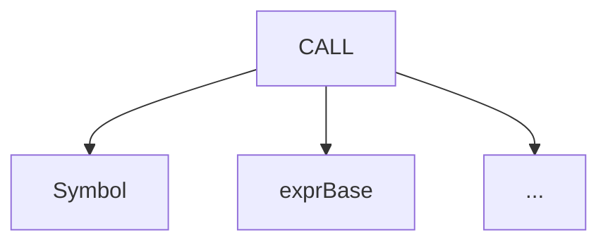

Le noeud `CALL` comprend :

- Le premier noeud correspond au nom de la fonction appelée.
- Les suivants correspondent aux arguments de l'appel (0 ou plusieurs).